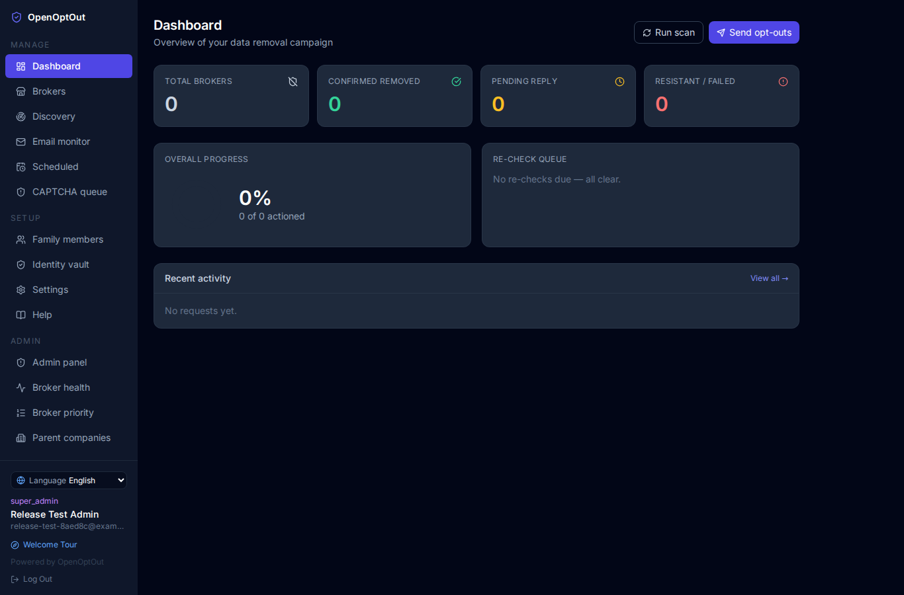
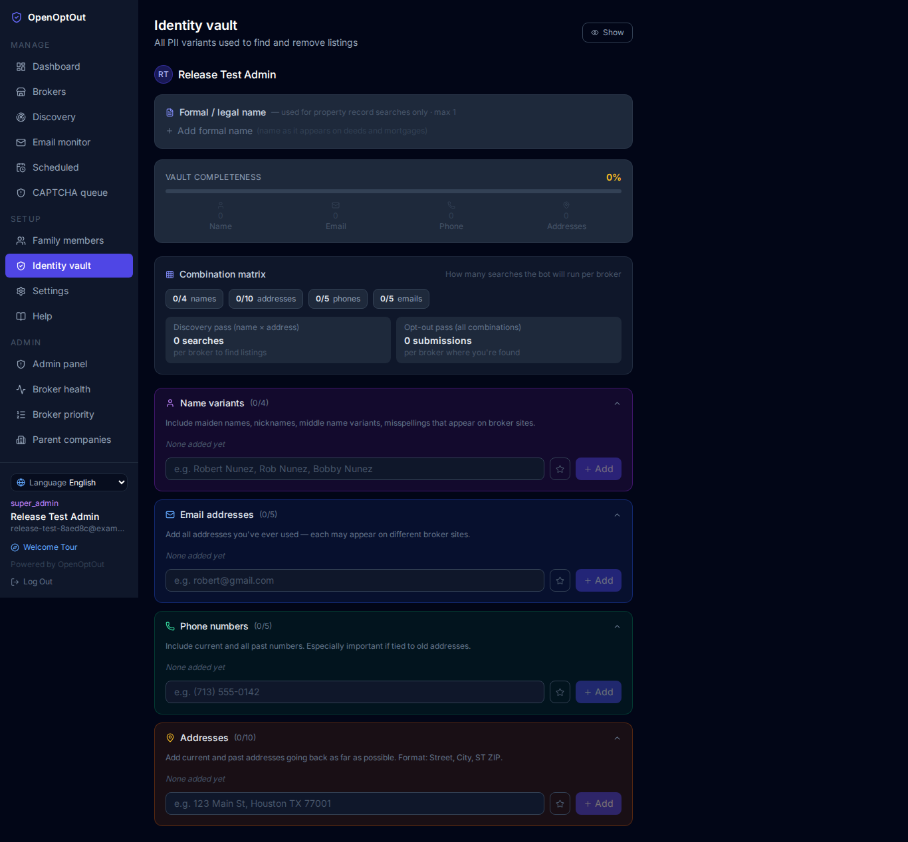

# OpenOptOut

**Open-source personal data removal pipeline.** Automated opt-out submission, confirmation tracking, and continuous defense against quiet data-broker re-listings.

[](LICENSE)
[](backend/plugins/bundled/brokers)
[](ACCESSIBILITY.md)
[](backend/plugins/bundled/languages)

OpenOptOut is a free, self-hostable privacy automation platform built for two audiences from the same codebase:
- **Families** — Single system with role-based access so parents can manage their children's data and spouses can coordinate removals together.
- **Institutions** (libraries, schools, credit unions, non-profits) — White-label branding, SSO/LDAP/SIP2 authentication, patron self-service, PostgreSQL for scale, database encryption, and privacy reporting.

> **Our Mission:** OpenOptOut is a stopgap. Having to hunt down brokers and beg for your own data is proof of a broken system. You should own your personal records by default. Read our full mission statement and library advocacy notes in [`docs/about/mission.md`](docs/about/mission.md).

---

## Features

- 🛡️ **Encrypted Identity Vault** — Store all name variants, aliases, emails, phone numbers, and addresses in a zero-knowledge, encrypted vault.
- 🔍 **Automated Broker Discovery** — Scan broker databases to pinpoint where your personal listings appear before filing removals.
- ⚡ **Pluggable Removal Engine** — Execute opt-outs via declarative specs or sandboxed gRPC plugins with corporate parent-company batching.
- 📬 **Email Confirmation Tracking** — Monitor a dedicated inbox via OAuth 2.0 or IMAP to match and verify incoming broker removal confirmations automatically.
- 🔄 **Continuous Re-Check Defense** — Automatically re-verify and re-submit requests on a scheduled cadence so brokers cannot quietly re-list you.
- 🏛️ **Built for Scale & Institutions** — Multi-branch partitioning with SIP2/ILS library card login, OIDC/SAML 2.0 SSO, distributed Redis priority workers, and PostgreSQL.
- ♿ **WCAG 2.2 AAA Accessible** — High-contrast themes, dynamic font scaling (100%–150%), reduced motion safety, skip links, and full keyboard/screen-reader support.
- 🔒 **Defense-in-Depth Security** — SQLCipher full-database encryption, Fernet field-level encryption, ephemeral memory zeroization, and container sandboxing.

---

## Preview

| Family Dashboard | Identity Vault |
|:---:|:---:|
|  |  |
| *Status overview across all family members* | *Store name variants, addresses, phones, emails* |

---

## Quick Start

### One-Line Automated Install (Recommended)

```bash
curl -fsSL https://raw.githubusercontent.com/rlnunez/OpenOptOut/main/install.sh | sh
```

The installer automatically detects your environment:
- Uses **Docker Compose** if Docker is installed and running.
- Installs **natively** (systemd + nginx, no containers) on Debian/Ubuntu systems without Docker.
- Safe to re-run: updates an existing checkout without overwriting `.env` configuration.
- To specify explicitly, use `| sh -s -- --docker` or `| sh -s -- --native`. See `install.sh --help` for details.

### Docker Compose (Manual)

```bash
# 1. Clone repository
git clone https://github.com/rlnunez/OpenOptOut.git openoptout
cd openoptout

# 2. Create environment file (or use ./install.sh to auto-configure security keys)
cp .env.example .env
# Auto-generate security keys with random lengths (128..256 hex chars) and lock permissions:
#   chmod 600 .env
# Master SECRET_KEY is generated by the admin in the web UI upon first sign-in
# via the interactive entropy mixer (combining images + mouse/typing entropy) or in .env.

# 3. Start containers
docker compose up -d

# 4. Open http://localhost in your browser
#    The first registered user automatically becomes the Super Admin
```

For real production deployments accessible over a network, always enable HTTPS before inviting users. See [`docs/admin/https.md`](docs/admin/https.md).

---

## Documentation

OpenOptOut documentation is organized by reader audience and powered by **[MkDocs](mkdocs.yml)**:

- 🏠 **[Documentation Portal](docs/index.md)** — Master hub with full-text search across all guides.
- 👨‍👩‍👧‍👦 **[User & Family Guide](docs/user/index.md)** — Setting up family email aliases, private SearXNG search, discovering opt-out forms, and removal verification monitoring.
- ⚙️ **[Administrator & Operations Guide](docs/admin/index.md)** — Automated HTTPS (Caddy/Traefik/Cloudflare), native bare-metal install, PostgreSQL, SSO/SAML, encrypted backups, and auto-rollback updates.
- 💻 **[Developer & Contributor Guide](docs/dev/index.md)** — System architecture, declarative broker interpreter runtime, [broker add-on authoring](broker-plugins/README.md), and security scanning.
- 📜 **[About & Governance](docs/about/index.md)** — Our [Mission & Principles](docs/about/mission.md) and plain-language [Privacy Legislation](docs/about/legislation.md) advocacy.
- 📋 **[Active Roadmap](docs/ROADMAP.md)** & **[Completed Milestones](docs/archive/COMPLETED_ROADMAP.md)** — Active/planned initiatives and historical milestone archive.
- 📝 **[Changelog](CHANGELOG.md)** — Semantic release notes cross-referencing all completed roadmap items.
- ♿ **[Accessibility Conformance](ACCESSIBILITY.md)** — WCAG 2.2 AAA conformance statement, high-contrast themes, and typography scaling.
- 🔒 **[Security Policy](SECURITY.md)** — Vulnerability reporting, cryptographic controls, and memory hygiene.

---

## Community & Contributing

We welcome community contributions, particularly:
- **Security & Architectural Reviews** — Review our sandboxing, cryptography, and auth architecture (see [`CONTRIBUTING.md`](CONTRIBUTING.md)).
- **Broker Selectors & Plugins** — Map new broker form selectors or build gRPC plugins to expand coverage (see [`broker-plugins/README.md`](broker-plugins/README.md)).
- **Accessibility Enhancements** — Verify workflows with screen readers and assistive devices (see [`ACCESSIBILITY.md`](ACCESSIBILITY.md)).
- **Bug Reports & Test Cases** — Help strengthen reliability across platforms.

All community members and contributors are expected to uphold our [`CODE_OF_CONDUCT.md`](CODE_OF_CONDUCT.md).

---

## License & Disclaimer

**GNU Affero General Public License v3.0 (AGPL-3.0).** Copyright © 2026 Robert Nunez.

You are free to use, study, modify, and self-host this software. If you run a modified version as a network service, you must make your modified source code available to users of that service. See [`LICENSE`](LICENSE) for the complete license terms.

OpenOptOut builds on the work of volunteers and other open-source projects. See [`CREDITS.md`](CREDITS.md) for who they are and how their work is used.

*Disclaimer: OpenOptOut submits opt-out requests on your behalf but cannot guarantee compliance from third-party data brokers. Re-check your listings periodically. OpenOptOut is not a legal service and does not provide legal advice.*
