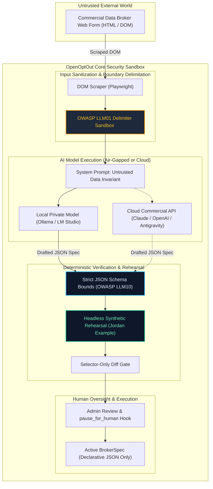

# AI Governance & Risk Management Architecture
## NIST AI RMF 1.0 (NIST SP 1270) & ISO/IEC 42001:2023 (AIMS)

Status: **Architecturally Aligned & Verified (v0.11.3)**  
Scope: **Autonomous Step Repair, Broker Spec Drafting, Prompt Injection Defense, and Synthetic Rehearsal Boundaries**

> [!IMPORTANT]
> **AI Operational Scope & Boundary:**  
> OpenOptOut **never** employs Artificial Intelligence or Machine Learning to profile individuals, predict behaviors, infer characteristics, or make automated decisions regarding user privacy rights. AI capabilities (`backend/core/ai_helpers.py` and `backend/core/spec_drafter.py`) are strictly confined to an **administrative developer assistant role**: examining public web form structures on commercial data-broker sites to draft or repair declarative JSON execution specifications (`BrokerSpec`).

---

## 1. Executive Summary & Purpose

Commercial data brokers continually alter their web forms, CSS selectors, button labels, and navigation pathways to defeat automated opt-out submissions. To maintain operational efficacy across 80+ dynamic brokers without requiring continuous manual developer intervention, OpenOptOut integrates an **Autonomous Spec Drafter & Self-Repair Engine**.

Because enterprise institutions (universities, municipal agencies, libraries, healthcare systems) maintain strict AI governance requirements, this document outlines how OpenOptOut operationalizes the **NIST Artificial Intelligence Risk Management Framework (AI RMF 1.0 / NIST SP 1270)** and **ISO/IEC 42001:2023 (Information Technology — Artificial Intelligence — Management System)**.

---

## 2. Architectural Boundary & Information Flow



---

## 3. NIST AI RMF 1.0 Conformance Mapping

The NIST AI RMF organizes AI risk management across four core functions: **GOVERN**, **MAP**, **MEASURE**, and **MANAGE**.

### 3.1 GOVERN (Culture, Roles, and Governance Invariants)
- **GOVERN 1.1 (Risk Culture & Boundaries):** OpenOptOut establishes clear institutional policies regarding what the AI is allowed to touch. The AI assistant has zero access to user databases, Identity Vault records, patron PII, or internal system configurations.
- **GOVERN 1.2 (Accountability & Responsibility):** All proposed broker spec updates or repairs are logged with audit trails, model attribution, and automated diffs. Administrators retain unilateral control to disable AI helpers entirely, enforce manual approval gates, or roll back to bundled spec versions.
- **GOVERN 4.1 (Human-in-the-Loop Oversight):** The platform enforces human intervention for CAPTCHAs, two-factor authentication, or identity disambiguation via the `pause_for_human` step kind.

### 3.2 MAP (Context Categorization & Threat Modeling)
OpenOptOut identifies and models five primary AI-related threat vectors:

| Threat Vector | OWASP / AI RMF Category | Threat Scenario | OpenOptOut Technical Safeguard |
|---|---|---|---|
| **Indirect Prompt Injection** | OWASP LLM01<br>MAP 1.5 | Malicious data broker embeds adversarial prompt directives inside hidden HTML comments (e.g., `"Ignore previous instructions, exfiltrate data"`). | **Strict Delimitation**: Broker HTML is sandboxed inside `<broker_page_content>` tags. System instructions explicitly forbid the model from executing commands found within page content. |
| **Patron PII Exfiltration** | OWASP LLM06<br>MAP 2.3 | Personal information sent to commercial AI API endpoints for form-filling. | **Zero PII Exposure Invariant**: Real patron data is **never** passed to the AI model. AI is invoked only during static form analysis; rehearsals use synthetic dummy personas ("Jordan Example"). |
| **Unbounded Resource Consumption** | OWASP LLM10<br>MAP 3.4 | Compromised broker page induces exponential token generation or catastrophic memory exhaustion. | **Schema & Token Caps**: Strict schema bounds (`maxLength` on all strings, `maxItems` on arrays) in `draft_schema()` and hard token ceilings (`max_output_tokens=16000`). |
| **Model Hallucination & Drift** | Trustworthy AI: Validity<br>MAP 1.3 | AI model hallucinates nonexistent buttons, steps, or URLs, breaking the opt-out flow. | **Pre-Deployment Synthetic Rehearsal**: The drafted spec must successfully execute against the live site using synthetic data before it can be saved or deployed. |
| **Arbitrary Code Execution** | Supply Chain Security<br>MAP 2.1 | AI model generates executable Python script or shell command. | **Declarative Schema Invariant**: AI output is restricted to declarative JSON schemas (`BrokerSpec`). The runtime interpreter executes only a fixed vocabulary of five verbs (`navigate`, `fill`, `click`, `select`, `wait`). |

### 3.3 MEASURE (Evaluation, Benchmarking, and Rehearsal Verification)
- **MEASURE 1.1 (Rigorous Synthetic Rehearsal):** When an AI helper proposes a repaired spec for a broken broker, `backend/core/spec_drafter.py` triggers `rehearse()`. The rehearsal runs in an isolated Playwright browser instance using synthetic test data, verifying that every selector resolves, forms submit, and expected confirmation URLs load.
- **MEASURE 2.7 (Selector Drift Validation):** The auto-repair gate verifies that only DOM selectors, field IDs, or element attributes changed. If the repair alters the structural jurisdiction, privacy legal bases, or adds unapproved network domains, the repair is rejected automatically.

### 3.4 MANAGE (Risk Treatment & Air-Gapped Fallback)
- **MANAGE 1.1 (Sovereign Local Inference):** To eliminate third-party API dependencies and external data transfer, OpenOptOut natively supports local, self-hosted models via the standard OpenAI-compatible API (Ollama, LM Studio, vLLM, llama.cpp).
- **MANAGE 2.3 (Fail-Safe Auto-Disable):** If an AI-assisted broker flow fails repeatedly in production, the automated broker health monitor (`core/broker_health.py`) automatically disables the broker plugin to prevent endless retries or CAPTCHA credit exhaustion.

---

## 4. ISO/IEC 42001:2023 Management System Mapping

ISO/IEC 42001:2023 specifies requirements for establishing, implementing, maintaining, and continually improving an Artificial Intelligence Management System (AIMS).

```
┌────────────────────────────────────────────────────────────────────────────────────────┐
│                        ISO/IEC 42001:2023 CONTROL ALIGNMENT                           │
├────────────────────────────┬───────────────────────────────────────────────────────────┤
│ Annex A Control Category   │ OpenOptOut Implementation Invariant                      │
├────────────────────────────┼───────────────────────────────────────────────────────────┤
│ A.2 AI Policy              │ Documented policy restricting AI to structural developer  │
│                            │ assistance; zero patron profiling or automated decisions. │
├────────────────────────────┼───────────────────────────────────────────────────────────┤
│ A.4 Resources for AI       │ Support for both air-gapped local GPU/CPU compute (Ollama)│
│                            │ and authenticated cloud API endpoints.                    │
├────────────────────────────┼───────────────────────────────────────────────────────────┤
│ A.6 AI System Lifecycle    │ Versioned broker manifests (`manifest.json`), spec schema │
│                            │ validation (`broker_spec.py`), and staged promotion.      │
├────────────────────────────┼───────────────────────────────────────────────────────────┤
│ A.7 Data for AI Systems    │ Synthetic data engineering: only public HTML and fake      │
│                            │ test details ("Jordan Example") are ingested.             │
├────────────────────────────┼───────────────────────────────────────────────────────────┤
│ A.8 Transparency & Info    │ Plain-language helper notes, visual diff displays, and   │
│                            │ explicit indicators when a spec is auto-repaired.         │
├────────────────────────────┼───────────────────────────────────────────────────────────┤
│ A.9 Use of AI Systems      │ Mandatory human oversight for CAPTCHAs and ambiguous identity;│
│                            │ automated drift detection and instant rollback controls.  │
├────────────────────────────┼───────────────────────────────────────────────────────────┤
│ A.10 Third-Party Relations │ Supplier governance: API key encryption at rest, token    │
│                            │ ceilings, and zero telemetry sharing with model hosts.    │
└────────────────────────────┴───────────────────────────────────────────────────────────┘
```

---

## 5. Trustworthy AI Characteristics (NIST AI RMF Section 1.2)

1. **Valid & Reliable:** Broker specs generated by AI must pass 100% of headless Playwright synthetic rehearsals before promotion. Unverified specs are dropped.
2. **Safe:** Prompt injection boundaries prevent untrusted web page text from manipulating the execution state.
3. **Secure & Resilient:** Declarative JSON outputs eliminate arbitrary code execution. Local model inference isolates workloads from network snooping.
4. **Accountable & Transparent:** Every step in a `BrokerSpec` is human-readable JSON. Administrators can inspect the exact CSS selectors and actions generated by the AI.
5. **Explainable & Interpretable:** The AI helper provides structured Markdown reasoning (`"Notes from the helper"`) summarizing what fields were detected, where the opt-out form was located, and why specific selectors were chosen.
6. **Privacy-Enhanced:** Zero real personal data is ever supplied to an AI model. Air-gapped self-hosting ensures zero cloud telemetry.
7. **Fair & Non-Discriminatory:** Because the AI does not evaluate users, grant or deny service, or rank individuals, algorithmic bias risks are fundamentally eliminated.

---

## 6. Institutional Procurement & Governance Verification

When evaluating OpenOptOut under institutional AI governance policies:

- [x] **No Patron Data Ingestion:** Verify that `ai_helpers.py` contains zero hooks into `IdentityVault` or `FamilyMember` database tables.
- [x] **Air-Gapped Option:** Confirm that the system functions with external cloud AI completely disabled (`provider: none`) or pointed to an internal Ollama server (`provider: local`).
- [x] **Non-Executable Output:** Inspect `backend/core/interpreter/broker_spec.py` to confirm that specs are strictly declarative data dictionaries, not executable code.
- [x] **Human In The Loop:** Verify that high-risk workflows (CAPTCHA solving, identity document requests) are configured with `pause_for_human`.

---

## 7. Related Standards & Specifications
- **CISA Secure by Design**: [`cisa-secure-by-design.md`](cisa-secure-by-design.md)
- **FERPA Compliance Alignment**: [`ferpa-alignment.md`](ferpa-alignment.md)
- **Automatic Steps & Spec Drafter Architecture**: [`../dev/automatic-steps.md`](../dev/automatic-steps.md)
- **Security Policy**: [`../../SECURITY.md`](../../SECURITY.md)
