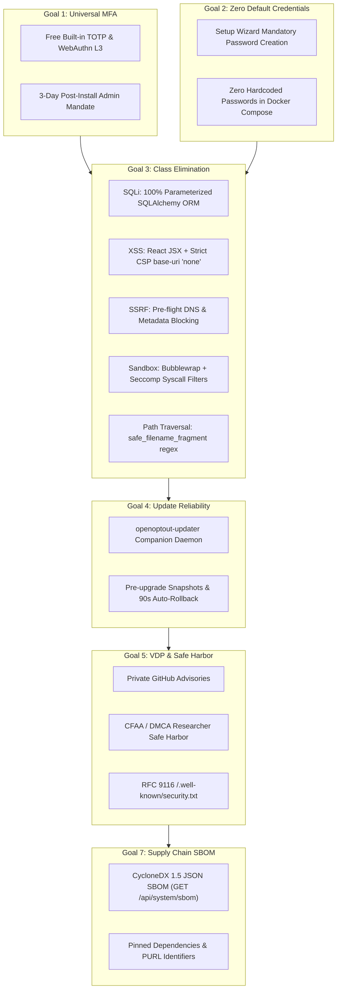

# CISA "Secure by Design" Architecture & Product Principles

Status: **Implemented & Architecturally Aligned (v0.11.3)**  
Scope: **Secure by Default, Vulnerability Class Elimination, Safe Harbor VDP, and Supply Chain Transparency**  

> [!IMPORTANT]
> **Guidance Alignment:** This document describes how OpenOptOut operationalizes the principles articulated in the joint cybersecurity guidance authored by the **Cybersecurity and Infrastructure Security Agency (CISA)**, **National Security Agency (NSA)**, **Federal Bureau of Investigation (FBI)**, and international partners (*"Shifting the Balance of Cybersecurity Risk: Principles and Approaches for Secure by Design Software"*).

---

## 1. Core Principles & Philosophy

Traditional software deployment models shift the burden of cybersecurity onto the end user or patron. For an open-source, self-hosted privacy appliance protecting families and dependent minors, OpenOptOut adheres to the three foundational CISA Secure by Design (SbD) principles:

1. **Take Ownership of Customer Security Outcomes:** Security must be the default baseline. Core security protections (MFA, field-level encryption, audit logging, single sign-on) are included out of the box with zero "security tax" or commercial tiers.
2. **Embrace Radical Transparency and Accountability:** The project publishes an explicit Vulnerability Disclosure Policy (VDP) with legal safe harbor for researchers, standard RFC 9116 discovery endpoints, and machine-readable Software Bills of Materials (SBOM).
3. **Build Organizational Structure to Eliminate Vulnerability Classes:** Rather than patching symptoms, the architecture systematically eradicates entire vulnerability classes (SQL injection, XSS, SSRF, sandbox escape, path traversal) using structural design boundaries.

---

## 2. Alignment with CISA Secure by Design Technical Goals

### Goal 1: Multi-Factor Authentication (MFA) Without a "Security Tax"
- **Zero Cost / No Paywalls:** Full MFA capabilities—including RFC 6238 TOTP, FIDO2 / W3C WebAuthn Level 3 (hardware YubiKeys, Google Titan, biometric passkeys), and cryptographic backup codes—are free and included directly in the base application.
- **Enforced Admin Hardening:** High-privilege administrative accounts (`super_admin`) are subject to a mandatory MFA setup window within 3 days of installation. Magic link authentication enforces step-up MFA (NIST SP 800-63B §3.1.3).

### Goal 2: Eliminate Default Passwords
- **No Hardcoded Credentials:** The appliance ships with no default passwords. During the first-run Setup Wizard (`SetupWizard.jsx`), the operator must create unique credentials satisfying a 15-character minimum length and a 10,000+ compromised password blocklist.
- **Fail-Closed Container Deployment:** Official Docker Compose configurations require explicit environment variables (`SECRET_KEY`, `REDIS_PASSWORD`), eliminating hardcoded database defaults.

### Goal 3: Systemic Elimination of Vulnerability Classes

OpenOptOut eliminates whole vulnerability classes at the architecture layer:

| Vulnerability Class | Architectural Mechanism | Enforcing Implementation |
|---|---|---|
| **SQL Injection (CWE-89)** | 100% Parameterized ORM | Complete reliance on SQLAlchemy ORM query abstractions; raw SQL string interpolation is strictly prohibited. |
| **Cross-Site Scripting (CWE-79)** | Safe DOM Construction & CSP | React JSX automatic string escaping, strict Content Security Policy (`base-uri 'none'`, `object-src 'none'`), and safe link protocol sanitization (`isSafeHref`). |
| **Server-Side Request Forgery (CWE-918)** | Pre-Flight DNS Verification | [`backend/core/dns_guard.py`](../../backend/core/dns_guard.py) (`assert_safe_url`, `safe_dns_context`) resolving and validating IPs against private subnets, loopbacks, and cloud metadata (`169.254.169.254`). |
| **Path Traversal (CWE-22)** | Character Set Restriction | [`backend/core/limits.py`](../../backend/core/limits.py) (`safe_filename_fragment`) constraining dynamic filename paths strictly to `[A-Za-z0-9_-]`. |
| **Sandbox Escape (CWE-265)** | OS-Level Virtualization | Bubblewrap user namespaces, Linux `seccomp` syscall filters, and memory-isolated worker processes executing broker add-ons. |
| **Command Injection (CWE-78)** | Direct Executable Invocation | Absence of shell evaluation (`shell=False`); execution uses parameter argument vectors with strict validation. |

### Goal 4: Reliable Updates and Automated Rollback
- **Companion Updater Daemon (`openoptout-updater`):** Manages isolated updates of the application fleet, executing pre-upgrade container and database snapshots.
- **Automated Revert:** If post-upgrade health checks fail within 90 seconds, the updater automatically reverts container images and restores database states.

### Goal 5: Vulnerability Disclosure Policy & Safe Harbor
- **Vulnerability Disclosure Policy ([`SECURITY.md`](../../SECURITY.md)):** Establishes a private reporting seam via GitHub Security Advisories.
- **Legal Safe Harbor:** Explicitly commits that good-faith security researchers operating within the declared scope will not face legal action under the Computer Fraud and Abuse Act (CFAA) or DMCA anti-circumvention provisions.
- **RFC 9116 Discovery Resource:** Implements `GET /.well-known/security.txt` and `GET /api/.well-known/security.txt` declaring official contact links, language preferences, policy URLs, and expiration timestamps.

### Goal 6: Transparent Vulnerability & CWE Accounting
- **Root-Cause Analysis:** Security advisories and commit records classify remediated issues using standard Common Weakness Enumeration (CWE) terms and OWASP ASVS verification numbers.

### Goal 7: Software Bill of Materials (SBOM) & Supply Chain Security
- **CycloneDX 1.5 JSON SBOM:** The appliance generates a machine-readable Software Bill of Materials via `GET /api/system/sbom` ([`backend/core/sbom.py`](../../backend/core/sbom.py)).
- **Package URL (PURL) Standard:** Runtime components and declared dependencies are indexed with standard purls (`pkg:pypi/...`), facilitating automated ingestion into vulnerability scanners, Trivy, and dependency monitoring tools.

---

## 3. Automated Verification

The CISA Secure by Design posture is verified in automated regression test suites:
- `security.cisa_secure_by_design_and_security_txt`: Asserts RFC 9116 `security.txt` syntax, safe harbor statements, and CycloneDX SBOM output.
- `ssrf.dns_rebinding_defense`: Asserts pre-flight rejection of cloud metadata and internal IPs.
- `auth.password_strength_and_blocklist`: Validates 15-char password floor and compromised password blocklists.

