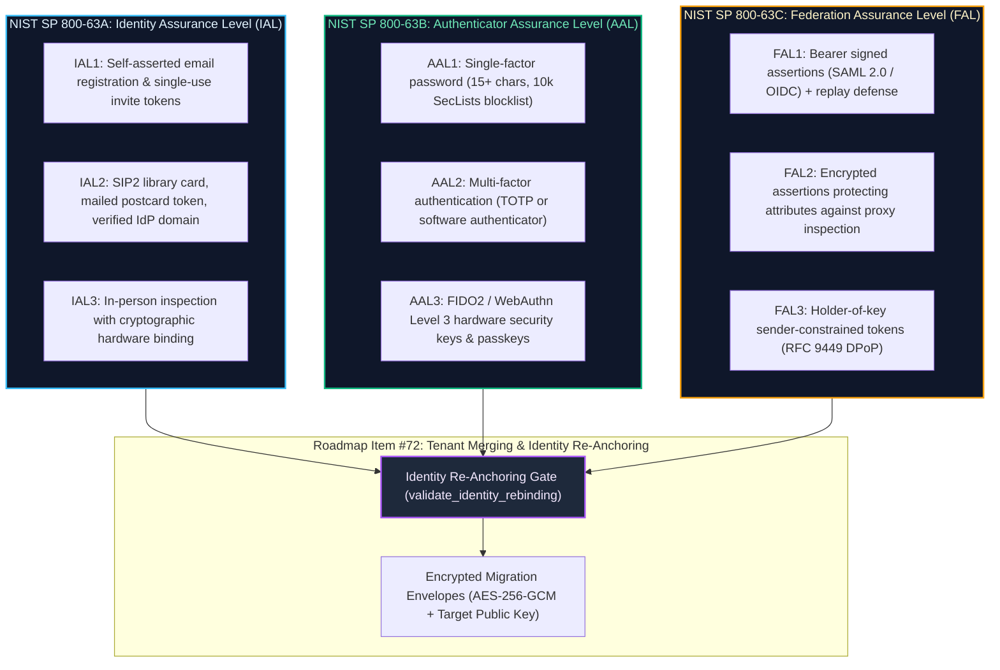

# Digital Identity Architecture & Assurance Guidelines
## NIST SP 800-63A (IAL), 800-63B (AAL), & 800-63C (FAL)
### Architectural Foundation for Instance Migration & Tenant Merging (Roadmap Item #72)

Status: **Implemented & Architecturally Aligned (v0.11.3)**  
Scope: **Identity Assurance Levels (IAL), Authenticator Assurance Levels (AAL), Federation Assurance Levels (FAL), and Identity Re-Anchoring Invariants**

> [!IMPORTANT]
> **Identity Governance & Item #72 Pre-Requisite:**  
> This specification codifies OpenOptOut's implementation of the **NIST SP 800-63 Digital Identity Guidelines**. It establishes the mandatory cryptographic and verification invariants required before enacting **Roadmap Item #72 (Instance migration, tenant merging & identity re-anchoring)**, preventing cross-tenant identity collisions, unverified account claiming, and authorization downgrade attacks.

---

## 1. Executive Summary & Purpose

When grassroots community instances merge into broader institutional deployments (such as a county library system, school district, municipal government, or regional consortium), user accounts and family identity vaults must transition from independent credentials to enterprise identity providers (SAML 2.0, OIDC, SCIM 2.0, or SIP2 ILS).

Without a formal identity assurance architecture, cross-tenant consolidation introduces severe vulnerability vectors:
1. **Unverified Account Claiming:** An attacker on a community server registers `mayor@city.gov` and claims the institutional account during merger.
2. **Assurance Downgrade:** A verified patron identity (IAL2) is overwritten by an unverified self-asserted profile (IAL1).
3. **Cross-Tenant Assertion Injection:** SAML/OIDC bearer assertions issued for one tenant are replayed against another.

OpenOptOut solves this through the programmatic **Identity Assurance Engine (`backend/core/identity_assurance.py`)** implementing **NIST SP 800-63-3 / 800-63-4**.

---

## 2. NIST SP 800-63 Digital Identity Triad



---

## 3. NIST SP 800-63A: Enrollment & Identity Proofing

NIST SP 800-63A establishes how applicants prove their identity before an account is bound to a credential.

### 3.1 Identity Assurance Levels in OpenOptOut

| Level | Criteria & Evidence Recognized | OpenOptOut Enrollment Workflow |
|---|---|---|
| **IAL1** | Self-asserted attributes. No official identity evidence required. | Standard grassroots registration via invitation code (`InviteCode`) or public self-registration with primary email confirmation token. |
| **IAL2** | Validated and verified identity evidence; address verification. | • **Library Patron Proofing**: Integrated Library System (ILS) barcode + PIN check via SIP2 protocol.<br>• **Community Postcard Tokens (Item 64)**: Physical mailings to residential addresses with single-use cryptographic activation tokens.<br>• **Enterprise Domain Verification**: SAML/OIDC federated assertions from verified institutional domains with `email_verified=True` and required group attributes.<br>• **Parental Representation**: Authorized representative consent capture for dependent minors. |
| **IAL3** | Supervised physical inspection; biometric or hardware token binding. | In-person staff verification with WebAuthn Level 3 hardware key registration for high-risk operators or system administrators. |

### 3.2 Enrollment & Proofing Invariants (§ 5.2 - § 5.4)
1. **Single-Use Cryptographic Tokens (§ 4.4):** Invitation and enrollment tokens are generated with at least 128 bits of cryptographic entropy, hashed at rest, time-bounded (default 7 days), and invalidated immediately upon first consumption or administrative revocation.
2. **Authorized Representative Proofing (§ 5.3.6):** Dependent minor vaults can only be created by an authenticated parent or legal guardian who asserts explicit authority to act (`MemberCreate.authorized`).
3. **Data Minimization & SSN Prohibition (§ 5.4):** OpenOptOut strictly forbids the ingestion or storage of Social Security Numbers, state ID card scans, or national identification numbers. Identity proofing relies strictly on non-sensitive institutional evidence (library cards, address postcards, campus SSO claims).

---

## 4. NIST SP 800-63C: Federation & Assertions

NIST SP 800-63C governs how relying parties (OpenOptOut instances) validate identity assertions issued by credential service providers or enterprise identity providers (SAML 2.0 IdPs, OIDC providers, SCIM clients).

### 4.1 Federation Assurance Levels in OpenOptOut

| Level | Technical Definition | OpenOptOut Implementation |
|---|---|---|
| **FAL1** | Signed bearer assertion. Replay-resistant via unique assertion IDs. | • **SAML 2.0**: XML digital signatures on assertion or response using xmlsec1; SP-initiated only (`InResponseTo` matching); single-use request IDs expiring in 600s.<br>• **OIDC**: JWS signature verification using IdP JSON Web Key Sets (JWKS). |
| **FAL2** | FAL1 + Encrypted assertion or encrypted attributes. | Encrypted SAML assertions (`EncryptedAssertion`) or JWE tokens ensuring proxy servers and TLS termination middleboxes cannot view patron attributes. |
| **FAL3** | FAL2 + Holder-of-key / sender-constrained token binding. | **RFC 9449 DPoP (Demonstrating Proof-of-Possession)**: Tokens are cryptographically bound to an asymmetric RSA/EC keypair held by the client, rejecting replayed bearer tokens even if intercepted over the network. |

### 4.2 Assertion Constraints & Replay Prevention (§ 6.1 & § 6.2)
All incoming federated assertions must pass `validate_assertion_constraints()` in `backend/core/identity_assurance.py`:
- **Audience Matching (`aud`):** The assertion audience must match the relying party's configured entity ID or client ID byte-for-byte.
- **Clock Skew Enforcement:** Expiration (`exp`) and not-before (`nbf`) claims are strictly enforced with a maximum clock-skew window of **60 seconds**.
- **Pairwise Subject Identifiers (§ 6.3):** Supports directed pseudonymous identifiers (`sub`) to prevent cross-site identity correlation.

---

## 5. Architectural Foundation for Roadmap Item #72

Roadmap Item #72 introduces **Instance migration, tenant merging & identity re-anchoring**. The NIST SP 800-63A/C engine provides the deterministic validation gates that make cross-tenant merging secure.

### 5.1 The Identity Re-Anchoring Gate (`validate_identity_rebinding`)

When migrating a user from a source community instance to a consolidated enterprise instance, `backend/core/identity_assurance.py` executes three mandatory verification gates:

```python
# Gate 1: IAL Protection (No Downgrade or Hijacking)
if source_ial == IAL2 and target_ial == IAL1 and not rebind_proof_token:
    raise IdentityAssuranceError("ial_downgrade_forbidden: cannot overwrite verified IAL2 account with unverified IAL1 assertion")

# Gate 2: Unverified Email Claiming Prohibition
if source_email == target_email and not target_assertion.get("email_verified"):
    raise IdentityAssuranceError("unverified_email_claiming_forbidden: target IdP has not verified this email address")

# Gate 3: Domain Authorization Verification
if trusted_domains and domain not in trusted_domains:
    raise IdentityAssuranceError("domain_not_authorized: domain is not within institutional whitelist")
```

### 5.2 Deterministic Merging Scenarios

1. **Clean Re-Anchoring (Same Human, Verified IdP):**  
   Patron has local account `patron@library.org` (IAL1). The library adopts OpenOptOut and connects campus SAML. The patron signs in via SAML with `email_verified=True` and matching domain.  
   *Result:* Re-anchoring permitted; account upgraded to IAL2; family vault keys retained.
2. **Adversarial Hijacking Attempt (Unverified Email):**  
   Attacker creates a personal Google account with `director@library.org` (without Google Workspace `hd` proof). Attacker attempts to sign in via Google SSO.  
   *Result:* Rejected under Rule 2 (`unverified_email_claiming_forbidden`). Local account remains untouched.
3. **Consolidation with New Identifier (Different Email):**  
   Patron registered locally with personal email `alice@gmail.com`. Institutional merger provisions `alice@city.gov`.  
   *Result:* Rebinding requires an explicit cryptographic rebind authorization challenge (`rebind_proof_token`) signed by Alice's source private key.

---

## 6. Verification & Automated Testing

The digital identity assurance engine is continuously validated in the Tier 1 automated security test suite:

- **`security.standards_nist_800_63a_and_800_63c`**:
  - Verifies IAL1, IAL2, and IAL3 resolution.
  - Verifies FAL1, FAL2, and FAL3 evaluation (including RFC 9449 DPoP binding).
  - Asserts audience matching, expiration rejection, and clock skew boundaries.
  - Tests identity re-anchoring conflict resolution (rejecting unverified email collisions and IAL downgrades).
  - Validates registration in `backend/core/privacy_record.py` `STANDARDS_ALIGNMENT`.

---

## 7. Related Standards & Specifications
- **CISA Secure by Design**: [`cisa-secure-by-design.md`](cisa-secure-by-design.md)
- **DPoP Sender-Constrained Tokens (RFC 9449)**: [`dpop-rfc-9449.md`](dpop-rfc-9449.md)
- **SCIM 2.0 Enterprise Identity (RFC 7643/7644)**: [`scim-enterprise-identity.md`](scim-enterprise-identity.md)
- **Key Management & Epoch Versioning (NIST SP 800-57)**: [`nist-key-management-800-57.md`](nist-key-management-800-57.md)
