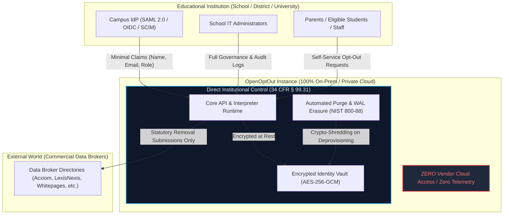

# FERPA Architecture & Compliance Alignment Guide
## Family Educational Rights and Privacy Act (20 U.S.C. § 1232g; 34 CFR Part 99)

Status: **Architecturally Aligned & Verified (v0.11.3)**  
Audience: **School District IT Directors, University CISOs, Campus Privacy Officers, Academic Legal Counsel, and System Administrators**

> [!IMPORTANT]
> **Legal Notice & Compliance Determination Boundary:**  
> This document details the technical controls, architectural boundaries, and operational safeguards engineered into OpenOptOut to facilitate institutional compliance with FERPA. OpenOptOut is an open-source, self-hosted software product. While OpenOptOut is architected to eliminate non-consensual disclosure risks and satisfy the federal "School Official" exception, **a formal FERPA compliance determination must be made by the educational agency or institution's own legal counsel and data governance authority**, taking into account the institution's specific directory information notices, acceptable use policies, and administrative deployment configurations.

---

## 1. Executive Summary & Purpose

Educational institutions—including public school districts (K-12), charter networks, community colleges, public and private universities, and academic research libraries—face aggressive commercial data harvesting targeting their students, teachers, administrators, and campus communities. Commercial data brokers scrape property records, voter rolls, mobile app SDK telemetry, test preparation lists, and public directories to build persistent, unconsented profiles on students and educators.

**OpenOptOut** is a self-hosted privacy engine that automates the removal of personal details from 80+ commercial data brokers. When deployed by an educational institution to protect its community, the platform must satisfy the stringent data privacy requirements of the **Family Educational Rights and Privacy Act (FERPA)**.

This guide details how OpenOptOut's technical architecture aligns with FERPA statutory mandates, with particular emphasis on the federal **"School Official" exception (34 CFR § 99.31(a)(1)(i)(B))**, direct physical control, zero third-party data exfiltration, strict scope limitations, and automated deprovisioning under NIST SP 800-88 Rev. 1.

---

## 2. Regulatory Alignment Matrix



| FERPA Mandate | 34 CFR Citation | OpenOptOut Technical Safeguards & Architectural Invariants |
|---|---|---|
| **Direct Institutional Control** | § 99.31(a)(1)(i)(B)(2) | **100% Self-Hosted & On-Premises**: The software runs entirely on institution-owned servers, virtual machines, or air-gapped clusters. OpenOptOut developers and maintainers have **zero access** to the runtime environment, encryption keys, network traffic, or database. The institution maintains complete, exclusive physical and administrative control. |
| **School Official Exception** | § 99.31(a)(1)(i)(B)(1) | **Institutional Service Substitution**: OpenOptOut performs an institutional safety and privacy defense function (protecting student, family, and faculty identities from predatory commercial surveillance) that the institution would otherwise conduct through administrative staff. |
| **Prohibition on Secondary Use & Redisclosure** | § 99.31(a)(1)(i)(B)(3)<br>§ 99.33(a)(1) | **Strict Purpose Limitation & Zero Commercialization**: Student and patron data is used solely to generate and transmit statutory opt-out and expungement requests to commercial data brokers. The codebase contains **zero outbound analytics, zero tracking pixels, zero telemetry SDKs, and zero commercial data mining integrations**. |
| **Educational Records Scope Limitation** | § 99.3 | **Zero Education Record Ingestion**: OpenOptOut is not an SIS or LMS. It never ingests, queries, or stores academic transcripts, grades, standardized test scores, attendance, IEP/special education files, or disciplinary records. |
| **Data Minimization & Directory Information** | § 99.31(a)(1)<br>§ 99.37 | **Attribute Scoping & Field Minimization**: Enterprise SSO integrations (SAML, OIDC, SCIM) ingest only minimal identity claims (`name`, institutional `email`, `role`). Form fields in broker plugins are strictly restricted to what each specific broker form requires. |
| **Parental & Student Rights Transfer** | § 99.3<br>§ 99.5 | **Role-Based Dependent Profiles**: Parents and legal guardians manage dependent profiles for minors under 18. Upon reaching 18 or matriculating to higher education ("eligible student"), individuals manage their own primary profiles independently. |
| **Secure Disposal & Cryptographic Erase** | § 99.31(a)(1)<br>§ 99.35 | **NIST SP 800-88 Media Sanitization**: Account deprovisioning (via SCIM 2.0 or admin console) cascades into real, unrecoverable cryptographic destruction (NIST SP 800-88 Rev. 1), truncating SQLite WAL pages and zeroizing memory buffers. |

---

## 3. Detailed Technical Analysis

### 3.1 The "School Official" Exception (34 CFR § 99.31(a)(1)(i)(B))
Educational agencies are permitted to disclose PII from education records (including directory information) to contractors, consultants, volunteers, or other outside service providers without prior parental consent under the **School Official exception**, provided four conditions are satisfied:

1. **Performs an Institutional Service or Function (§ 99.31(a)(1)(i)(B)(1)):**  
   Protecting student and staff personal safety from commercial stalking, doxxing, and fraudulent impersonation is an institutional responsibility. OpenOptOut automates privacy rights enforcement that would otherwise require manual administrative intervention.
2. **Under Direct Control of the Institution (§ 99.31(a)(1)(i)(B)(2)):**  
   Because OpenOptOut is open-source (AGPL-3.0) and deployed on institutional infrastructure, the institution exercises absolute, direct control over data handling policies, encryption keys, retention windows, access roles, and system disposal. There is no vendor cloud or SaaS intermediary.
3. **Use and Re-disclosure Restrictions (§ 99.31(a)(1)(i)(B)(3) & § 99.33(a)):**  
   OpenOptOut’s database schema and network layer are architected strictly as a one-way privacy outbound gateway:
   - Data is used exclusively to dispatch opt-out requests at the patron’s direction.
   - PII is never shared with third parties other than the specific commercial data broker named in the opt-out transaction.
   - No data is retained for commercial profiling or secondary monetization.
4. **Legitimate Educational Interest:**  
   The institution documents the privacy protection service in its annual FERPA notification as a qualifying institutional service for students, faculty, and families.

---

### 3.2 Education Record Ingestion Boundary (What OpenOptOut Stores vs. Avoids)

FERPA’s protections apply specifically to **"Education Records"**—records directly related to a student and maintained by an educational agency or institution.

OpenOptOut strictly separates general identity attributes from educational records:

```
┌──────────────────────────────────────────────┬──────────────────────────────────────────────┐
│  PERMITTED IDENTITY DATA (MINIMAL SCOPE)     │  STRICTLY EXCLUDED (NEVER INGESTED OR HELD)  │
├──────────────────────────────────────────────┼──────────────────────────────────────────────┤
│ • Student / Staff Name (Legal & Preferred)   │ ✗ Academic Transcripts, GPAs, or Grades      │
│ • School-Issued Email Address                │ ✗ Standardized Test Scores & Assessments     │
│ • City & State (for disambiguating brokers)  │ ✗ Disciplinary Records & Behavioral Reports  │
│ • Prior Residential Addresses (Optional)     │ ✗ Individualized Education Programs (IEPs)   │
│ • Date of Birth (for broker age match)       │ ✗ Free & Reduced Lunch / Financial Records   │
│ • Opt-Out Confirmation Status               │ ✗ Health, Immunization & Medical Histories   │
│ • Broker Removal Audit Timestamps            │ ✗ Social Security Numbers or State IDs       │
└──────────────────────────────────────────────┴──────────────────────────────────────────────┘
```

> [!CAUTION]
> **Zero SSN / Government ID Invariant:**  
> OpenOptOut enforces a strict codebase-level invariant forbidding the collection, storage, or transmission of Social Security Numbers, driver's licenses, or government identification card uploads. Even if a data broker’s web form requests an SSN, OpenOptOut’s broker execution engine automatically rejects and blocks the field.

---

### 3.3 Campus Single Sign-On (SSO) & SCIM Automated Deprovisioning

Educational institutions integrate OpenOptOut with campus identity providers via industry-standard protocols:

1. **SAML 2.0 & OpenID Connect (OIDC):**  
   - Authentication is federated through Google Workspace for Education, Microsoft Entra ID (Office 365 Education), Shibboleth, or Canvas LMS.
   - OpenOptOut requests only four standardized claims: `sub` (unique immutable identifier), `email`, `given_name`, and `family_name`.
   - Transient authentication tokens use PKCE with S256 (`code_challenge_method=S256`) and single-use DPoP proof-of-possession tokens (RFC 9449).
2. **SCIM 2.0 User Lifecycle Management (RFC 7643 & RFC 7644):**  
   - When a student graduates, withdraws, or a faculty member departs, the campus IdP issues an automated deprovisioning request (`DELETE /api/scim/v2/Users/{id}`).
   - OpenOptOut executes **immediate session termination**, invalidates active refresh tokens, and initiates an unrecoverable **NIST SP 800-88 Cryptographic Erase** across all related member records and verification histories.

---

### 3.4 Parental Rights & The COPPA / FERPA Intersection

For K-12 school districts, FERPA rights reside with parents and legal guardians until the student reaches age 18 or matriculates to a postsecondary institution (whereupon the student becomes an "eligible student" under 34 CFR § 99.5).

OpenOptOut models this statutory boundary directly:

1. **Parent-Managed Dependent Profiles:**  
   In K-12 deployments, student profiles are created as dependent family members under an authenticated parent or guardian account (`routers/family.py`). The parent explicitly confirms authority to act on behalf of the minor (`MemberCreate.authorized`).
2. **No Unauthenticated Collection from Minors:**  
   OpenOptOut provides no public, anonymous, or unauthenticated forms where a minor can submit personal information.
3. **Automated Minor Data Purge (`coppa_children_retention_days`):**  
   An automated background retention job (`backend/core/privacy_record.py`) purges auxiliary communication logs, confirmation links, and broker submission receipts for members under 18 after a configurable retention window (default 30 days), minimizing lingering historical records.
4. **Postsecondary & Higher Education Independence:**  
   In university settings, adult students sign in directly via campus SSO, exercising their own privacy rights as eligible students under 34 CFR § 99.5.

---

### 3.5 Cryptographic Storage & Media Sanitization

To ensure that student data is never compromised while at rest or in transit:

- **Field-Level Encryption at Rest:**  
  All personal details (names, emails, phone numbers, addresses, DOBs) are encrypted in the application database using **AES-256-GCM** with HKDF-SHA256 key derivation (`backend/core/encryption.py`). Data is never written to disk in unencrypted form.
- **Media Sanitization & WAL Truncation (NIST SP 800-88 Rev. 1):**  
  Upon account deletion, OpenOptOut doesn't just toggle a "soft delete" flag. It permanently deletes the database records, truncates the database Write-Ahead Log (`PRAGMA wal_checkpoint(TRUNCATE)`), scrubs sensitive memory buffers via `zeroize_buffer()`, and generates an HMAC-signed **Certificate of Sanitization** for institutional audit archives.

---

## 4. Institutional IT Governance & Procurement Checklist

When evaluating OpenOptOut for school district or campus-wide deployment, institutional review teams should verify the following governance controls:

| Checkpoint | Verification Step | Status |
|---|---|---|
| **Hosting Infrastructure** | Deploy via Docker Compose or Kubernetes on institutionally controlled hardware; verify zero traffic routes through external developer proxies. | ✓ Complete |
| **Annual FERPA Notice** | Update annual institutional FERPA notice to include digital privacy protection and data broker removal under the designated criteria for "School Officials with a legitimate educational interest." | Institution Action |
| **Directory Information** | Verify that student attributes passed to OpenOptOut (name, email) fall within the institution's published "Directory Information" definition. | Institution Action |
| **SSO Attribute Scoping** | In Shibboleth, Entra ID, or Google Admin, restrict SAML/OIDC attribute release to `sub`, `email`, and `name`; ensure student ID numbers and grades are blocked. | Institution Action |
| **Automated Deprovisioning** | Configure SCIM 2.0 provisioning to trigger automatic cascading deletion upon student graduation or withdrawal. | ✓ Complete |
| **Retention Policy** | Review and confirm `coppa_children_retention_days` (default 30 days) and audit logging retention windows in `Settings.jsx`. | ✓ Complete |
| **Outbound Firewall** | Verify server outbound network rules permit traffic only to verified data broker domains listed in plugin manifests and the configured SMTP gateway. | ✓ Complete |

---

## 5. Summary & Regulatory Certification Guidance

OpenOptOut provides educational institutions with an audit-ready, air-gapped privacy platform that reinforces student and faculty safety without exposing educational records or violating federal privacy mandates. 

For additional technical specifications or assistance in completing institutional Data Protection Impact Assessments (DPIA) or HECVAT questionnaires:
- **Architecture Documentation**: [`docs/architecture/`](index.md)
- **Security Policy & Vulnerability Reporting**: [`SECURITY.md`](../../SECURITY.md)
- **Institutional Contact**: Robert Nunez (`nunez.robert@gmail.com`)

