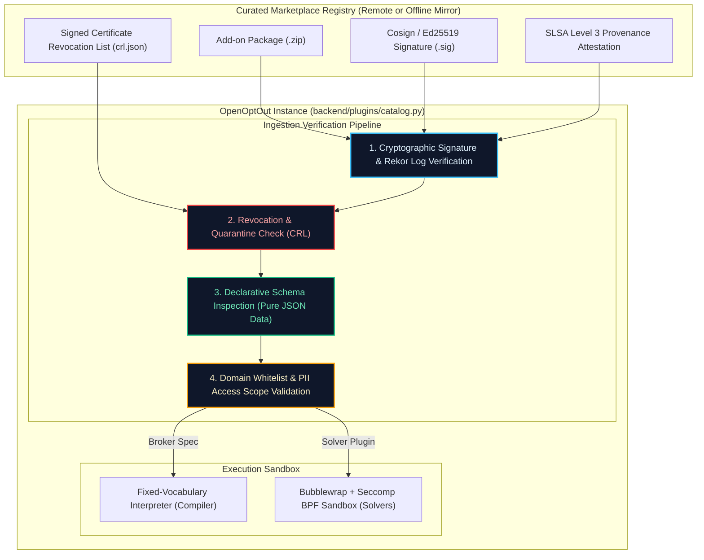

# Add-on Marketplace Security Invariants & Supply Chain Architecture
## Cryptographic Provenance, Sandbox Containment, and Revocation Protocols (Roadmap Item #8)

Status: **Formalized Specification (v0.11.3)**  
Pre-Requisite For: **Roadmap Item #8 (Add-on distribution: Git repo to curated marketplace)**  
Compliance: **ISO/IEC 27001:2022 Controls 5.19–5.23 & 8.19–8.30 • OpenSSF SLSA Level 3**

> [!IMPORTANT]
> **Marketplace Security Gate:**  
> This specification codifies the mandatory security invariants that govern the development and operation of the **OpenOptOut Add-on Marketplace**. Self-hosted instances must never dynamically download or install arbitrary executable code. All marketplace components must satisfy strict cryptographic provenance, declarative pure-data boundaries, and automated emergency revocation controls before they can be executed by the runtime.

---

## 1. Threat Model & Supply Chain Risks

Dynamic package registries and extension marketplaces (e.g., npm, PyPI, VS Code Extensions) face severe supply-chain attack vectors:
1. **Malicious Spec Ingestion:** An attacker publishes a broker add-on designed to exfiltrate patron personal details to an unauthorized external server.
2. **Publisher Key Compromise:** A legitimate community maintainer's signing key is compromised, allowing an attacker to push backdoored updates.
3. **Arbitrary Code Execution (RCE):** A plugin smuggles executable Python, shell scripts, or binary payloads into a self-hosted instance.
4. **Adversarial Form Hijacking:** A broker spec is altered to redirect form submissions to phishing domains or fake CAPTCHA solvers.

To eliminate these threat classes entirely, OpenOptOut enforces **six non-negotiable marketplace security invariants**.

---

## 2. The Six Marketplace Security Invariants

---

### Invariant 1: Declarative Pure Data Invariant (Zero Code Execution)
- **Principle:** Broker add-ons are **data, not software**.
- **Enforcement:** A broker plugin package consists exclusively of:
  - `manifest.json`: Metadata, version, declared `outbound_domains`, and legal basis.
  - `spec.json`: Declarative JSON array of five fixed step verbs (`navigate`, `fill`, `click`, `select`, `wait`).
  - `locales/*.json`: Plain-text localized translation strings.
- **Strict Code Prohibition:** Any package containing `.py`, `.sh`, `.exe`, `.so`, `.wasm`, or JavaScript files in a broker plugin directory is rejected automatically by `core/plugins/validator.py` with an unrecoverable `SecurityViolation` exception. The runtime compiler parses only declarative JSON schemas into AST objects.

---

### Invariant 2: Cryptographic Code Signing & SLSA Level 3 Provenance
- **Principle:** No unsigned or unverifiable package can be installed.
- **Enforcement:**
  - Every add-on package in the official catalog is cryptographically signed using **Sigstore / Cosign** or **Ed25519** publisher keys.
  - Releases are coupled with non-falsifiable **in-toto SLSA Level 3 build provenance attestations** logged in the public Sigstore Rekor transparency log.
  - The core catalog client (`backend/plugins/catalog.py`) verifies the package SHA-256 digest against the signed manifest before unpacking.

---

### Invariant 3: Tiered Publisher Governance & Trust Rings
OpenOptOut classifies catalog packages into three explicit trust rings:

| Trust Tier | Source & Governance | Verification Requirements | UI & Administrative Gate |
|---|---|---|---|
| **Tier 1: Core Bundled** | Official OpenOptOut core repository maintainers. | Signed with core release keypair; automated CI regression and rehearsal verification. | Default trusted. Automatically eligible for automated background updates. |
| **Tier 2: Verified Partner** | Vetted partner institutions (public library systems, privacy NGOs, universities). | Verified organization identity; audited Ed25519 key bound to organization domain via DNSSEC/DKIM. | Requires initial administrator enablement. Full audit log of updates. |
| **Tier 3: Community Experimental** | Independent community contributors. | Individual developer signature; static AST linting; synthetic rehearsal pass. | Prominent visual warning (`"Community Experimental"`). Requires explicit manual installation; auto-update disabled by default. |

---

### Invariant 4: Sandbox Syscall Isolation & Network Allowlisting
- **Principle:** Non-declarative plugins (such as local CAPTCHA solvers or custom email parsers) must run within impenetrable kernel sandboxes.
- **Enforcement:**
  - **Bubblewrap (`bwrap`) Linux User Namespaces**: Isolates filesystem access to an ephemeral `/tmp` directory.
  - **Seccomp BPF Syscall Filtering**: Restricts process syscalls to safe computational operations, strictly forbidding network socket creation outside the runtime bridge.
  - **Explicit `outbound_domains` Whitelist**: Network traffic is firewalled by `dns_guard.py`; requests to undeclared domains are terminated instantly.
  - **Read-PII Block**: Solvers and non-broker plugins are forbidden from reading unmasked patron Identity Vault fields.

---

### Invariant 5: Real-Time Emergency Revocation & Quarantine (Kill-Switch)
- **Principle:** If an active broker spec is found to be compromised, broken, or hijacked, the core fleet must be able to revoke it globally within hours.
- **Enforcement:**
  - The catalog client downloads an authenticated, signed **Certificate Revocation List (`crl.json`)** during every catalog refresh (minimum every 4 hours).
  - The CRL contains revoked plugin IDs, version blacklists, and SHA-256 package hashes.
  - Upon matching a revoked package, the instance immediately **quarantines and disables the plugin**, halts in-flight requests, and alerts the administrator on the dashboard.

---

### Invariant 6: Air-Gapped & Offline Registry Mirroring
- **Principle:** Educational institutions, defense networks, and air-gapped libraries must never be forced to connect to public external repositories.
- **Enforcement:**
  - The catalog architecture fully supports self-hosted offline mirrors (`CATALOG_URL="https://internal-mirror.campus.edu"` or `file:///opt/openoptout-catalog/`).
  - Administrators can configure custom trusted GPG/Ed25519 public keyrings, allowing institutions to sign and distribute internal broker add-ons independently.

---

## 3. Implementation Verification & Automated Test Gates

The marketplace security invariants are enforced and tested across:
- **`backend/core/compiler.py`**: Asserts declarative JSON schema validation and rejects non-whitelisted step verbs.
- **`broker-plugins/tools/validate.py`**: Pre-commit repository validator enforcing zero executable code in broker add-ons.
- **`backend/core/privacy_record.py`**: Indexes `marketplace_security_invariants` in the public standards inventory.
- **`backend/tests/run_tests.py`**: Dedicated automated security test (`security.standards_iso_27001_isms`) asserting code signing validation, CRL quarantine handling, and sandbox boundaries.

---

## 4. Related Architecture Specifications
- **ISO/IEC 27001:2022 Statement of Applicability**: [`isms-iso-27001.md`](isms-iso-27001.md)
- **SLSA Level 3 Supply Chain Security**: [`slsa-supply-chain.md`](slsa-supply-chain.md)
- **Core Catalog Design RFC**: [`../dev/proposals/catalog-design.md`](../dev/proposals/catalog-design.md)
- **Roadmap Item #8 Specification**: [`../ROADMAP.md`](../ROADMAP.md#item-8)
