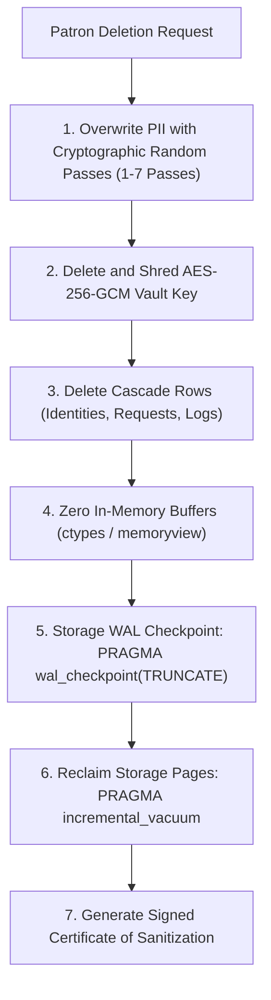

# NIST SP 800-88 Rev. 1 Media Sanitization & Cryptographic Erase

This document specifies OpenOptOut's implementation of **NIST Special Publication 800-88 Revision 1 (Guidelines for Media Sanitization)** Section 5.1, governing Cryptographic Erase (CE) of personal data and residual storage cleanup.

---

## 1. Overview & Regulatory Rationale

When a patron exercises their Right to Erasure under GDPR, CCPA/CPRA, or COPPA, simply executing an SQL `DELETE` is insufficient under federal media sanitization standards:
- **Write-Ahead Logging (WAL):** Relational database storage engines (such as SQLite and PostgreSQL) maintain write-ahead logs that retain historic unallocated pages containing unencrypted personal data and cryptographic key blobs on disk.
- **Unallocated Storage Blocks:** Deleted database rows leave freed pages marked as available, but un-overwritten until reused.
- **In-Memory Buffers:** Decrypted keys and identity objects may persist in runtime RAM buffers until garbage collected.

OpenOptOut implements a multi-stage **Cryptographic Erase (CE)** procedure ensuring irrecoverable data destruction.

---

## 2. Sanitization Pipeline

When an administrator or patron initiates account deletion (`DELETE /api/family/{id}` or `DELETE /api/scim/v2/Users/{id}`):



---

## 3. Cryptographic Certificate of Sanitization

Under NIST SP 800-88 Rev. 1 Section 4.8, sanitization actions must be verified and documented with an auditable Certificate of Sanitization.

OpenOptOut emits a machine-readable JSON certificate generated by [`backend/core/sanitization.py`](../../backend/core/sanitization.py):

```json
{
  "certificate_id": "4a781292-871d-4034-8c88-e8cb5ec09d31",
  "standard": "NIST SP 800-88 Rev. 1",
  "sanitization_type": "Cryptographic Erase (CE)",
  "subject_hash": "a1b2c3d4...64-hex",
  "key_reference_hash": "e5f6a7b8...64-hex",
  "shred_passes": 3,
  "storage_procedures": [
    "field_level_cryptographic_key_shred",
    "sqlite_wal_checkpoint_truncate",
    "storage_vacuum_reclaim",
    "memory_hygiene_zeroization"
  ],
  "status": "VERIFIED_DESTROYED",
  "operator": "system_automated",
  "timestamp": "2026-10-24T23:00:00Z",
  "hmac_signature": "9f8e7d...64-hex"
}
```

> [!IMPORTANT]
> The Certificate of Sanitization contains **zero plaintext personal data**. Only irreversible SHA-256 hashes of subject and key identifiers are recorded, signed with an HKDF-derived subsystem HMAC key to guarantee authenticity.
