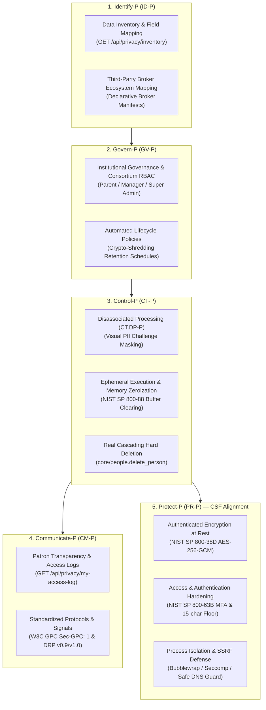

# NIST Privacy Framework — Cybersecurity Framework (CSF) Privacy Profile

Status: **Implemented & Architecturally Aligned (v0.11.3)**  
Scope: **Privacy Risk Management, CSF Intersection, Disassociated Processing, and Technical Safeguards**  

> [!IMPORTANT]
> **Legal Disclaimer:** This document describes the technical architecture, controls, and risk management mechanisms implemented in OpenOptOut to align with the **NIST Privacy Framework: A Tool for Improving Privacy through Enterprise Risk Management (Version 1.0)** and the **Cybersecurity Framework (CSF) Privacy Profile**. It does not constitute a formal compliance determination, legal advice, or statutory certification. Deploying organizations (libraries, municipalities, enterprises) should consult their own legal counsel regarding compliance determinations.

---

## 1. Context & Architectural Overview

The NIST Privacy Framework complements the NIST Cybersecurity Framework (CSF) by addressing two distinct categories of risk:
1. **Cybersecurity Risks:** Privacy events arising from security failures (unauthorized access, malicious intrusion, data exfiltration).
2. **Privacy Risks:** Unintended adverse consequences arising as a byproduct of *authorized, intentional personal data processing* (e.g., unintended data aggregation, excessive collection, loss of patron control, third-party disclosure).

In OpenOptOut, the core objective is to shield family members and patrons from third-party surveillance by automating removal requests to data brokers. Because personal data must interact with external broker websites, the architecture implements the **NIST CSF Privacy Profile** to ensure that data processing remains strictly minimized, disassociated, and cryptographically protected throughout its lifecycle.

---

## 2. Core Functions & Technical Controls

### Function 1: Identify-P (ID-P)
*Identify and understand data processing risks, systems, and ecosystem touchpoints.*

- **Inventory and Mapping (ID.IM-P):**
  - **Machine-Readable Data Inventory (`GET /api/privacy/inventory`):** Transparently details all collected PII categories (`names`, `contact`, `birthday`, `requests`, `emails`, `logs`, `access`), storage encryption mechanisms, and retention periods.
  - **Zero-SSN Baseline:** Enforces that Social Security numbers, government ID scans, payment card details, and readable passwords are never collected or stored (`NEVER_STORED`).
- **Data Processing Ecosystem Risk Management (ID.DE-P):**
  - **Broker Plugin Specifications (`broker_spec.py`):** Explicitly defines required input fields, HTTP target domains, and jurisdiction rules for every supported broker, preventing unpredictable data leakage.
  - **Aggregator Targeting Graph:** Identifies and targets upstream master data aggregators to eliminate personal listings at the root of the data ecosystem.

### Function 2: Govern-P (GV-P)
*Establish and monitor privacy governance, organizational roles, and automated lifecycle controls.*

- **Governance Policies & Multi-Tenant Boundaries (GV.PO-P):**
  - **Role-Based Access Control (RBAC):** Strict operational boundaries separating super-administrators, institutional library managers, and family account holders (`ProfileAccess`).
  - **Parental Representation Verification:** Records affirmative proxy consent (`TermsAcceptance`, `kind="acting_for"`) before managing dependent profiles.
- **Monitoring and Review (GV.MT-P):**
  - **Configurable Retention Schedules:** Granular retention timers for raw automation logs, auxiliary verification artifacts, staff audit logs, and COPPA child records (`privacy_record.py`).
  - **Automated Crypto-Shredding Purge (`core/privacy_record.py`):** Daily background purge enforcing the retention schedule, vacuuming deleted storage, and logging shredding metrics.

### Function 3: Control-P (CT-P)
*Enable individuals and operators to manage data processing with granularity, minimization, and disassociation.*

- **Disassociated Processing (CT.DP-P):**
  - **Visual PII Masking (`core/captcha_privacy.py`):** When CAPTCHA challenges require resolution, all personal names, email addresses, phone numbers, and address fragments are blacked out before transmission to any external solver.
  - **Field Minimization:** Forms are submitted with only the minimal fields demanded by each specific broker form—never transmitting unneeded profile data.
  - **Ephemeral Buffer Zeroization (`core/memory_hygiene.py`):** Decrypted identity variants and plaintext secrets exist only in ephemeral process memory and are zeroized immediately following execution.
- **Data Processing Management (CT.DM-P):**
  - **Real Hard Deletion (`core/people.delete_person()`):** Real cascading delete with multi-pass overwrites that eradicates family members, identities, contact addresses, and request histories. Soft deletion is strictly prohibited.
  - **Anti-Automation Rate Limiting (`core/automation.py`):** Protects against resource exhaustion, CAPTCHA credit depletion, and uncontrolled submission bursts (ASVS 2.4.1).

### Function 4: Communicate-P (CM-P)
*Facilitate transparent, bidirectional communication regarding data processing and privacy preferences.*

- **Data Processing Awareness (CM.AW-P):**
  - **Patron Access Log (`GET /api/privacy/my-access-log`):** Allows patrons and family members to review every instance where an administrator or staff member accessed or exported their data.
  - **Full Data Portability (`GET /api/privacy/export`):** Enables self-service export of complete family identity vaults, active requests, and removal confirmations in human-readable JSON.
- **Mechanisms for Exchanging Information (CM.EL-P):**
  - **Universal Opt-Out Signal (W3C GPC):** Transmits `Sec-GPC: 1` and `navigator.globalPrivacyControl = true` across all automated browser contexts, and serves `GET /.well-known/gpc.json`.
  - **Data Rights Protocol (DRP v0.9/v1.0):** Standardized programmatic interface supporting `/exercise`, `/status`, and `/.well-known/data-rights` discovery.

### Function 5: Protect-P (PR-P) [CSF Security Alignment]
*Implement technical safeguards to prevent cybersecurity privacy events and protect personal data.*

- **Data Security (PR.DS-P):**
  - **Authenticated Encryption at Rest (NIST SP 800-38D):** High-sensitivity fields (identities, formal legal names, dates of birth) are encrypted with AES-256-GCM authenticated encryption.
  - **Key Derivation & Peppering (NIST SP 800-132):** PBKDF2 password derivation with 210,000 iterations and domain-separated HKDF key schedules.
- **Identity Management, Authentication, and Access Control (PR.AC-P):**
  - **Lifecycle Hardening (NIST SP 800-63B):** 15-character minimum password floor, 10,000+ offline compromised password blocklist, TOTP counter-replay defenses, WebAuthn FIDO2 keys, and mandatory MFA on magic links.
  - **Session Security:** Granular per-device session revocation (`UserSession`), role-based idle timeouts, and 30-day "Remember Me" session caps.
- **Protective Technology (PR.PT-P):**
  - **Runtime Sandboxing:** Bubblewrap namespaces, Linux `seccomp` system call filters, and strict filesystem isolation for broker plugins.
  - **Pre-Flight SSRF Protection (`core/dns_guard.py`):** Validates all outbound network requests against RFC 1918 private subnets, loopback addresses, and cloud metadata endpoints (`169.254.169.254`).
  - **Frontend Isolation:** Consolidated Content Security Policy (`base-uri 'none'`), `Cross-Origin-Opener-Policy: same-origin`, and conditional HSTS.

---

## 3. Automated Regression Verification

The NIST Privacy Framework and CSF Privacy Profile alignment is continuously validated by automated test suites in [`backend/tests/run_tests.py`](../../backend/tests/run_tests.py):
- `privacy.nist_privacy_framework_alignment`: Verifies that the data inventory and standards metadata correctly map all 5 core functions and disassociated processing controls without leaking system diagnostics.
- `privacy.no_details_in_logs`: Validates that no plaintext PII appears in application logs or tracebacks.
- `crypto.field_encryption_roundtrip`: Asserts AES-256-GCM AEAD authenticated encryption integrity.
- `ssrf.dns_rebinding_defense`: Asserts blocking of loopback and cloud metadata requests.

