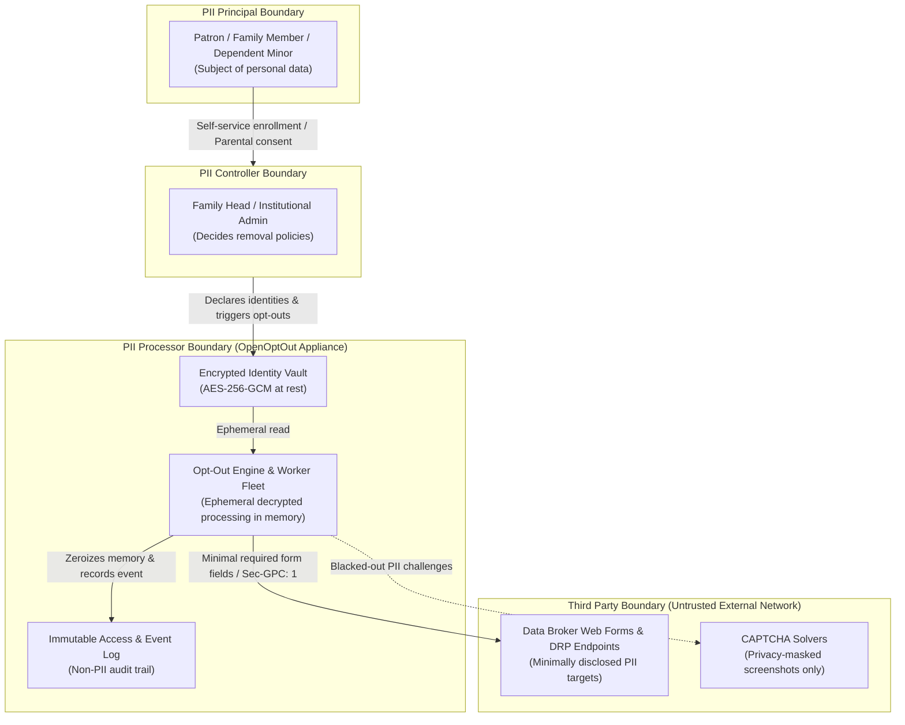

# ISO/IEC 29100 Privacy Architecture Framework

Status: **Implemented & Architecturally Aligned (v0.11.3)**  
Scope: **Privacy Architecture, Trust Boundaries, Role Mapping, and Technical Controls**  

> [!IMPORTANT]
> **Legal Disclaimer:** This document describes the technical architecture and security boundaries implemented in OpenOptOut to align with the **ISO/IEC 29100:2011 Privacy Framework** standard. It does not constitute a formal compliance determination, legal advice, or statutory certification (e.g. COPPA, GDPR, CCPA). Self-hosters and deploying institutions should consult their own legal counsel regarding compliance determinations in their specific jurisdiction.

---

## 1. Architectural Vision & Context

OpenOptOut is a self-hosted appliance designed to discover and remove personal information of families, dependents, and patrons from online data brokers and people-search databases. Because it processes sensitive personal data—including minors' details under parental custody—privacy and data protection are foundational system attributes, not secondary features.

**ISO/IEC 29100:2011** provides a high-level privacy framework for Information and Communication Technology (ICT) systems processing Personally Identifiable Information (PII). This specification details how OpenOptOut's technical architecture implements the **4 Privacy Roles** and adheres to the **11 Privacy Principles** defined in ISO/IEC 29100.

---

## 2. ISO/IEC 29100 Role Definitions & Boundaries

ISO/IEC 29100 (§4) defines four structural roles governing personal data processing:

### 1. PII Principal
The natural person whose PII is shielded.
- **Dependent Family Members:** Minors or dependents managed under the authenticated custody of a parent/guardian account. In accordance with COPPA rules, no unauthenticated path ever collects a minor's data.
- **Independent Patrons:** Adult patrons who authenticate directly via institutional identity providers (e.g. public library SIP2 cards, university SAML 2.0, enterprise OIDC).

### 2. PII Controller
The individual or organizational entity deciding the purposes and means of processing PII.
- **Home / Family Deployments:** The primary account holder / parent configuring opt-out policies for their household.
- **Institutional / Library Deployments:** The public library district, municipal authority, or consortium administrator managing tenant boundaries and regional privacy schedules.

### 3. PII Processor
The automated processing system executing removal instructions on behalf of the controller.
- **OpenOptOut Core Engine:** Interprets declarative broker opt-out specifications, coordinates verification cycles, and enforces crypto-shredding purges.
- **Distributed Worker Fleet:** Stateless execution workers running in isolated container/sandbox boundaries, zeroizing memory buffers immediately after each step.

### 4. Third Party
External entities outside the controller/processor security boundary.
- **Data Brokers & Covered Businesses:** Third parties receiving minimization-filtered opt-out requests, DRP payloads, and GPC signals.
- **CAPTCHA Solvers:** Isolated third-party services receiving challenge images that have been pre-processed to black out all family PII (`core/captcha_privacy.py`).

---

## 3. Mapping the 11 ISO/IEC 29100 Privacy Principles

OpenOptOut translates the 11 foundational privacy principles into enforceable code, database constraints, and cryptographic safeguards:

### Principle 1: Consent and Choice (§5.2)
- **Parental & Representation Consent:** When managing a dependent family member, the controller explicitly affirms authorization (`MemberCreate.authorized`), immutably logged in `TermsAcceptance` (`kind="acting_for"`).
- **Universal Opt-Out Choice (GPC & DNT):** Browser automation contexts and network requests automatically assert the W3C Global Privacy Control (`Sec-GPC: 1`, `navigator.globalPrivacyControl = true`) and Do Not Track (`DNT: 1`) signals, legally signaling universal opt-out under CCPA/CPRA and CPA.
- **No Unconsented Secondary Use:** Personal data is never repurposed for telemetry, marketing, analytics, or behavioral modeling.

### Principle 2: Purpose Legitimacy and Specification (§5.3)
- **Single Legitimate Purpose:** Personal data is processed exclusively for the purpose of removing personal listings from data brokers, verifying expungement, and proving compliance.
- **Purpose Specification at Collection:** Every field collected in `FamilyMember` and `Identity` is paired with an explicit justification documented in the machine-readable data inventory (`core/privacy_record.py`).

### Principle 3: Collection Limitation (§5.4)
- **Zero-SSN Policy:** OpenOptOut never collects, stores, prompts for, or submits Social Security numbers, government ID scans, payment card details, or readable passwords.
- **Form-Specific Collection:** Plugin execution steps query only the specific fields required by that broker's opt-out form—never submitting an unvetted full profile.

### Principle 4: Data Minimization (§5.5)
- **Field-Level Encryption (AES-256-GCM):** High-sensitivity fields (addresses, phone numbers, email variants, legal names, dates of birth) are encrypted at rest using dedicated field encryption keys.
- **Visual PII Masking:** CAPTCHA challenge images dispatched to external solvers have all personal names, emails, and phone fragments blacked out prior to egress (`core/captcha_privacy.py`).
- **Memory Hygiene & Zeroization:** Decrypted identity buffers are explicitly wiped from memory (`core/memory_hygiene.py`) immediately upon completing task execution.
- **Log Sanitization:** Application logs, error tracebacks, and broker execution logs strictly redact all PII (`core/logging_config.py`).

### Principle 5: Use, Retention and Disclosure Limitation (§5.6)
- **Automated Retention Schedules:** Configurable lifecycle timers automatically purge auxiliary data (temporary challenge screenshots, broker HTML snapshots, confirmation links).
- **Minor Data Shredding Floor:** Auxiliary verification data for dependents under 18 is purged on a strict retention window (default 30 days) to comply with COPPA data minimization expectations.
- **Multi-Pass Crypto-Shredding:** Member profile deletions execute real hard deletes with multi-pass overwrites (`core/people.delete_person()`) cascading through all removal requests and variant mappings. Soft deletes are strictly prohibited.

### Principle 6: Accuracy and Quality (§5.7)
- **Identity Variant Matrix:** Supports multiple legitimate name variants, prior residential addresses, and historical phone numbers to ensure complete suppression coverage across broker indices.
- **Removal Verification Engine:** Scheduled verification routines re-crawl broker databases at cadenced intervals (30, 60, 90 days) to detect re-listings and verify continued removal accuracy.

### Principle 7: Openness, Transparency and Notice (§5.8)
- **Machine-Readable Data Inventory (`GET /api/privacy/inventory`):** Transparently exposes the categories of data collected, encryption state, processing justification, and retention rules.
- **W3C GPC Discovery (`GET /.well-known/gpc.json`):** Publicly advertises support for the W3C Global Privacy Control community specification.
- **DRP Discovery (`GET /.well-known/data-rights`):** Standards-compliant discovery endpoint for automated data rights transactions.

### Principle 8: Individual Participation and Access (§5.9)
- **Self-Service Data Export (`GET /api/privacy/export`):** Patrons and parents can export their complete personal record, active removal requests, and confirmation receipts in readable JSON format at any time.
- **Self-Service Hard Deletion (`DELETE /api/family/{id}`):** Patrons can permanently delete their family profile and identity vault on demand without administrative gatekeeping.

### Principle 9: Accountability (§5.10)
- **Immutable Staff Access Log (`AccessLog`):** Any inspection, data export, or deletion of a member profile by an administrator or manager is permanently recorded with timestamps, actor IDs, and actions (`core/privacy_record.py`).
- **Patron Audit Visibility (`GET /api/privacy/my-access-log`):** Patrons can inspect the access audit log for their own family to verify who looked at their data and when.
- **Fail-Closed Envelope Verification:** Distributed worker queues require HMAC-SHA256 signature verification on every execution envelope, preventing unauthorized job dispatch.

### Principle 10: Information Security (§5.11)
- **Process Isolation & Sandboxing:** Broker plugins execute within Bubblewrap namespaces and strict seccomp filters blocking arbitrary system calls and unauthorized network egress.
- **SSRF & DNS Rebinding Defense:** All outbound HTTP requests, OIDC discoveries, and DRP endpoints are pre-flight validated against loopback, link-local, and cloud metadata targets (`core/dns_guard.py`).
- **OWASP ASVS 5.0 L2 Hardened Controls:** 15-character password floor, 10k+ offline common password blocklist, TOTP replay prevention, WebAuthn FIDO2 keys, and strict Content Security Policy (`base-uri 'none'`).

### Principle 11: Privacy Compliance (§5.12)
- **Multi-Jurisdiction Alignment:** Declarative broker specifications declare statutory regimes (`jurisdiction`, `legal_language`) mapping opt-out legal rights across CCPA/CPRA, GDPR, Colorado CPA, LGPD, and COPPA.
- **Prohibition on Complacency:** Compliance is treated as an active technical discipline requiring continuous automated verification, unit testing (`backend/tests/run_tests.py`), and independent third-party audits.

---

## 4. Technical Verification & Test Suite

The ISO/IEC 29100 privacy architecture is validated on every build via automated regression tests:
- `backend.tests.run_tests --only privacy.`: Tests data inventory generation, crypto-shredding purge routines, access log retention, and export completeness.
- `backend.tests.run_tests --only gpc.`: Validates W3C Global Privacy Control header injection and DOM property definitions.
- `backend.tests.run_tests --only drp.`: Validates Data Rights Protocol schema compliance and SSRF mitigation.
- `backend.tests.run_tests --only security.`: Validates memory hygiene, secret zeroization, password floors, and envelope integrity.

