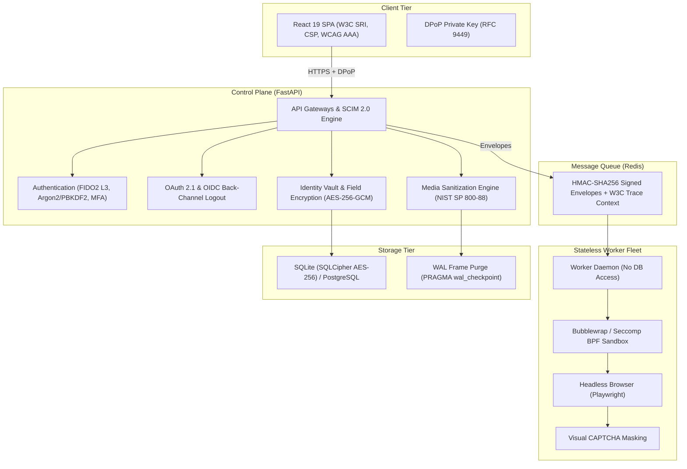

# Independent Security Review & Penetration Testing Audit Scope

This document specifies the formal audit scope, architecture boundaries, threat models, cryptographic invariants, and test harnesses for independent third-party security evaluators and penetration testing firms (e.g., OSTIF, Radically Open Security, Cure53).

---

## 1. Executive Summary & Appliance Description

**OpenOptOut** is a self-hosted, AGPL-3.0 licensed personal data removal appliance purpose-built for families, patrons, and public institutions (including public library districts and educational agencies). It automates the discovery, opt-out submission, verification, and recurring monitoring of personal details across commercial data brokers.

Because OpenOptOut processes sensitive personal records—including minors' data under COPPA and patron circulation records under state library privacy statutes—the platform is engineered under a strict **Zero-Trust & Secure-by-Design** architecture.

---

## 2. Target Standards & Compliance Baselines

Independent evaluations are conducted against the following formal standards:

| Framework / Standard | Verification Level | Scope Focus |
| :--- | :--- | :--- |
| **OWASP ASVS 5.0.0** | Level 2 / Level 3 | Authentication, session revocation, input validation, CSP, and cryptographic boundaries. |
| **CISA Secure by Design** | Full Alignment | Class elimination (SQLi, XSS, SSRF, Path Traversal, Sandbox Escape), universal free MFA, radical transparency. |
| **NIST SP 800-57 Part 1 Rev. 5** | Cryptoperiod Alignment | Epoch key versioning (`gcm:v{epoch}:`) and automated background re-encryption pipelines. |
| **NIST SP 800-88 Rev. 1** | Cryptographic Erase (CE) | Physical storage residual elimination, SQLite WAL frame truncation, and verifiable destruction receipts. |
| **W3C WebAuthn L3 / FIDO2 L3** | Hardware Token Bound | User Verification (UV flag `0x04`), Backup Eligibility (`BE`), Ed25519 (`alg: -8`), and `credProps`. |
| **OAuth 2.1 & RFC 9700** | Strict BCP | Unconditional PKCE S256, exact redirect URI matching, and refresh token rotation with family revocation. |
| **RFC 9449 (DPoP)** | Application Sender-Constraining | Asymmetric proof validation, RFC 7638 thumbprints (`jkt`), and single-use `jti` replay caching. |
| **SCIM 2.0 (RFC 7643 / 7644)** | Institutional Provisioning | Service provider configuration, user lifecycle sync, deactivation session revocation, and deprovisioning shredding. |
| **W3C Subresource Integrity (SRI)**| Asset Digest Verification | SHA-384 integrity hashes on all SPA frontend script and stylesheet tags. |
| **ISO/IEC 27701:2019 & 29100** | PIMS & Privacy Roles | Statutory ROPA (GDPR Art. 30), DPIA (GDPR Art. 35), and disassociated processing safeguards. |
| **COPPA (16 CFR Part 312)** | Minors' Data Protection | Parental authorization, 30-day auxiliary data retention floors, and real cascading deletion. |

---

## 3. In-Scope Architecture Boundaries



### In-Scope Codebase Modules:
1. **Web Frontend (`frontend/src/`)**: Session storage, DPoP key management, safe anchor URL parsing (`isSafeHref`), focus trap controls, and anti-XSS auto-escaping.
2. **API & Routers (`backend/routers/`)**: Role-based access control (RBAC), multi-tenant isolation, SCIM 2.0 provisioning (`scim.py`), OIDC back-channel logout (`auth.py`), and privacy endpoints (`privacy.py`).
3. **Cryptographic Core (`backend/core/`)**:
   - `encryption.py`: AES-256-GCM, HKDF key derivation, epoch versioning (`gcm:v{epoch}:`), and re-encryption.
   - `sanitization.py`: NIST SP 800-88 Cryptographic Erase, SQLite WAL checkpoint truncation, and signed certificate generation.
   - `oauth_engine.py` & `dpop.py`: OAuth 2.1 PKCE enforcement, refresh token reuse detection, and DPoP proof validation.
   - `mfa.py`: WebAuthn L3 assertion validation, UV flag enforcement, and Ed25519 signature checks.
   - `tracing.py`: W3C Trace Context generation and distributed envelope propagation.
4. **Worker Queue & Envelope Serialization (`backend/core/distributed/`)**:
   - `envelope.py`: Deterministic canonical JSON serialization, HKDF-isolated HMAC-SHA256 signing, and in-memory buffer zeroization.
5. **Process Sandboxing (`backend/core/interpreter/` & `backend/plugins/`)**:
   - Linux bubblewrap namespace isolation, seccomp BPF syscall filtering, `limits.py` filesystem guards, and network domain allowlist routing.

---

## 4. Out-of-Scope Components & Rules of Engagement

The following are **strictly out of scope** for external security evaluators:
1. **Third-Party Broker Websites:** Evaluators must **never** attack, flood, or submit real personal details to external commercial data broker websites (e.g., Whitepages, BeenVerified, Radaris).
   - Evaluators must use the app's native rehearsal mode (`core/spec_drafter.rehearse()`), mocked HTTP fixtures, or isolated dry-run environments (`DryRunExecutor`).
2. **Third-Party Email / OAuth Providers:** Production Google Workspace or Microsoft 365 identity servers.
3. **Denial of Service (DoS / DDoS):** Volumetric network flooding against hosted infrastructure.
4. **Social Engineering & Phishing:** Attacking project maintainers, community operators, or library patrons.

---

## 5. Threat Model & Assumed Adversary Capabilities

| Threat Actor | Capabilities & Entry Point | Evaluator Focus Area |
| :--- | :--- | :--- |
| **Malicious Broker / Adversarial Web Page** | Untrusted HTML/JS rendered in headless Playwright browser frames during automated form filling. | Test for browser sandbox escape (bubblewrap/seccomp breakout), local filesystem traversal, internal port scanning (SSRF), and malicious redirect evasion. |
| **Untrusted Patron / Multi-Tenant Attacker** | Authenticated low-privilege user account on a shared institutional instance. | Test for Insecure Direct Object References (IDOR), cross-family vault access, privilege escalation to manager/admin, and SCIM endpoint unauthorized access. |
| **Compromised Network Intermediary** | Intercepts HTTP traffic between client SPA and API server (e.g. compromised reverse proxy). | Test RFC 9449 DPoP token replay resistance, session hijacking defenses, HSTS enforcement, and SRI validation. |
| **Malicious Community Plugin Author** | Crafts an adversarial broker plugin or solver add-on uploaded by an administrator. | Test AST static analysis (`code_inspector.py`), path traversal guards in ZIP extraction, permission bypass, and host network isolation. |
| **Database Compromise / Physical Drive Theft** | Acquires raw SQLite database file or filesystem backup image. | Test AES-256-GCM field encryption bounds, key derivation resistance (PBKDF2 210,000 iterations + pepper), and absence of residual plaintext in WAL pages after crypto-shredding. |

---

## 6. Non-Negotiable Security Invariants

Auditors should verify that the application enforces these core invariants under all failure conditions:

1. **Zero Unencrypted PII at Rest:**
   - Names, residential addresses, emails, phone numbers, and dates of birth must never be written to persistent disk storage unencrypted.
2. **Zero Plaintext Personal Data in Logs:**
   - Identity combinations are scrubbed by `logging_config.py`. Raw PII must never appear in log files, console streams, or error responses.
3. **Zero SSN Collection:**
   - The platform strictly rejects, never requests, and provides no schema fields for Social Security Numbers or government ID card images.
4. **Complete Cryptographic Shredding:**
   - Deletion of a patron or dependent cascades to all removal requests, event histories, and vault keys, accompanied by `PRAGMA wal_checkpoint(TRUNCATE)` and in-memory buffer zeroization (`ctypes.memset`).
5. **Fail-Closed Distributed Queue Verification:**
   - Worker nodes must refuse and quarantine any job envelope whose HMAC signature is missing, invalid, or expired.
6. **Constant-Time Verification:**
   - All cryptographic comparisons (HMAC digests, TOTP codes, API tokens) must use constant-time algorithms (`hmac.compare_digest`) to prevent timing side channels.

---

## 7. Test Harnesses & Auditor Execution Commands

Auditors can execute OpenOptOut's comprehensive automated security test suites locally:

```bash
# 1. Run all security and cryptographic regression suites
python3 -m backend.tests.run_tests --only security.

# 2. Run privacy and disassociated processing test suites
python3 -m backend.tests.run_tests --only privacy.

# 3. Validate broker plugins and AST static analysis guards
python3 broker-plugins/tools/validate.py

# 4. Verify internationalization and language packs
python3 scripts/plugin_texts.py --check

# 5. Build and verify frontend W3C Subresource Integrity (SRI)
cd frontend && npm run check:names && npm run build
```

---

## 8. Reporting & Vulnerability Disclosure

Security evaluators operating in good faith are protected under OpenOptOut's **Security Researcher Safe Harbor** (detailed in [`SECURITY.md`](../../SECURITY.md)):

* **Disclosure Portal:** [GitHub Private Security Advisory Portal](https://github.com/rlnunez/OpenOptOut/security/advisories/new)
* **RFC 9116 Metadata:** [`/.well-known/security.txt`](../../.well-known/security.txt)
* **OASIS CSAF 2.0:** [`/.well-known/csaf/provider-metadata.json`](../../.well-known/csaf/provider-metadata.json)
